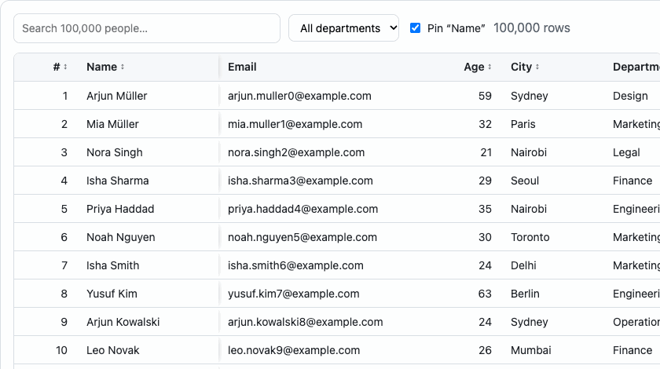

<!-- The package README (shown on npm) lives in packages/tablekit/README.md. -->

# TableKit

**A small, fast, accessible React data table.** Virtualization and keyboard accessibility are built in, not bolted on.

[](https://www.npmjs.com/package/react-tablekit)
[](https://github.com/himanshusingh11/tablekit/actions/workflows/ci.yml)
[](#bundle-size)
[](https://github.com/himanshusingh11/tablekit/blob/main/LICENSE)

**[Docs & live demos →](https://himanshusingh11.github.io/tablekit/)**



- ⚡ **100K rows at 60 fps.** In-house row virtualization keeps about 23 rows in the DOM.
- ♿ **Accessible by default.** ARIA `grid` pattern, roving tabindex and full keyboard navigation. `aria-rowindex` stays correct while virtualized.
- 🔃 **Sorting** (stable, multi-column), **filtering** (global + per column), **column resize**, **left pinning**, **row selection** (shift-range, select all filtered).
- 🧩 **Typed** column definitions with generics. **Controlled or uncontrolled** state.
- 🌐 **Client or server**: `manualSorting` / `manualFiltering` for API-driven tables.
- 🎨 **Themeable** with CSS variables. **Zero runtime dependencies.** About 5 KB JS + 1 KB CSS (brotli).

## Install

```sh
npm install react-tablekit
```

Peer dependencies: `react` and `react-dom` 18 or 19.

## Quick start

```tsx
import { useTable, DataTable, type ColumnDef } from 'react-tablekit';
import 'react-tablekit/styles.css';

type User = { id: string; name: string; email: string; age: number };

// Keep columns referentially stable: module scope or useMemo.
const columns: ColumnDef<User>[] = [
  {
    id: 'name',
    header: 'Name',
    accessor: (r) => r.name,
    sortable: true,
    filterable: true,
    width: 200,
  },
  { id: 'email', header: 'Email', accessor: (r) => r.email, filterable: true },
  { id: 'age', header: 'Age', accessor: (r) => r.age, sortable: true, align: 'right' },
];

export function UsersTable({ data }: { data: User[] }) {
  const table = useTable({
    data,
    columns,
    getRowId: (r) => r.id,
    enableRowSelection: true,
  });

  return (
    <>
      <input
        placeholder="Search…"
        value={table.state.globalFilter}
        onChange={(e) => table.setGlobalFilter(e.target.value)}
      />
      <DataTable table={table} height={600} rowHeight={40} aria-label="Users" />
    </>
  );
}
```

### Server-side mode

```tsx
const table = useTable({
  data: page.rows,
  columns,
  getRowId: (r) => r.id,
  manualSorting: true,
  manualFiltering: true,
  rowCount: page.total, // keeps aria-rowcount honest
  onSortingChange: (sorting) => refetch({ sorting }),
  onFiltersChange: (filters) => refetch({ filters }),
  onGlobalFilterChange: (q) => refetch({ q }),
});
```

### Controlled state

Pass any slice in `state` and handle changes. Slices you don't pass stay internal.

```tsx
const [sorting, setSorting] = useState<SortingState>([{ id: 'age', desc: true }]);
const table = useTable({
  data,
  columns,
  getRowId,
  state: { sorting },
  onSortingChange: setSorting,
});
```

## Keyboard

| Keys                                                             | Action                                                               |
| ---------------------------------------------------------------- | -------------------------------------------------------------------- |
| <kbd>Tab</kbd>                                                   | Enter / leave the grid (single tab stop)                             |
| <kbd>↑</kbd> <kbd>↓</kbd> <kbd>←</kbd> <kbd>→</kbd>              | Move between cells                                                   |
| <kbd>Home</kbd> / <kbd>End</kbd>                                 | First / last cell in row                                             |
| <kbd>Ctrl</kbd>+<kbd>Home</kbd> / <kbd>Ctrl</kbd>+<kbd>End</kbd> | First / last cell in grid                                            |
| <kbd>PageUp</kbd> / <kbd>PageDown</kbd>                          | Move by one viewport                                                 |
| <kbd>Enter</kbd> on header                                       | Sort (<kbd>Shift</kbd> to add to multi-sort)                         |
| <kbd>Space</kbd>                                                 | Toggle row selection (<kbd>Shift</kbd>+<kbd>Space</kbd> for a range) |
| <kbd>Ctrl</kbd>/<kbd>⌘</kbd>+<kbd>A</kbd>                        | Select all filtered rows                                             |
| <kbd>Alt</kbd>+<kbd>←</kbd>/<kbd>→</kbd> on header               | Resize column                                                        |
| <kbd>Enter</kbd> on row                                          | `onRowClick`                                                         |

## API

### `ColumnDef<T>`

| Prop                                 | Type                                 | Notes                                               |
| ------------------------------------ | ------------------------------------ | --------------------------------------------------- |
| `id`                                 | `string`                             | Unique, stable                                      |
| `header`                             | `ReactNode`                          |                                                     |
| `accessor`                           | `(row: T) => CellValue`              | Value for display, sort and filter                  |
| `cell?`                              | `(row: T, value) => ReactNode`       | Custom renderer                                     |
| `sortable?` / `filterable?`          | `boolean`                            | `filterable` columns take part in the global filter |
| `sortFn?`                            | `(a: T, b: T) => number`             | Custom ascending comparator                         |
| `filterFn?`                          | `(row: T, value: string) => boolean` | Custom predicate                                    |
| `width?` / `minWidth?` / `maxWidth?` | `number`                             | Defaults 150 / 50 / 1000                            |
| `resizable?`                         | `boolean`                            | Default `true`                                      |
| `pinned?`                            | `boolean`                            | Pin left initially                                  |
| `align?`                             | `'left' \| 'center' \| 'right'`      |                                                     |

### `useTable(options)` → `Table<T>`

Options: `data`, `columns`, `getRowId`, `enableRowSelection`, `enableMultiSort` (default `true`), `manualSorting`, `manualFiltering`, `rowCount`, `initialState`, `state`, `onStateChange`, `onSortingChange`, `onFiltersChange`, `onGlobalFilterChange`, `onRowSelectionChange`, `onColumnSizingChange`, `onColumnPinningChange`.

The returned table exposes `rows`, `rowIds`, `state`, `toggleSort`, `setSorting`, `getSortDirection`, `setGlobalFilter`, `setColumnFilter`, `getColumnFilter`, `toggleRowSelected`, `selectRange`, `toggleAllRowsSelected`, `selectAllStatus`, `getSelectedRows`, `setColumnWidth`, `resetColumnWidth`, `toggleColumnPinned` and `setState`.

### `<DataTable />`

`table`, `height` (400), `rowHeight` (40), `headerHeight`, `overscan` (5), `loading`, `emptyState`, `loadingState`, `aria-label`, `aria-labelledby`, `onRowClick`, `getRowClassName`, `className`, `style`.

### `react-tablekit/core`

Framework-agnostic pure functions (no React): `sortRows`, `filterRows`, `getNextSorting`, `selectRange`, `getColumnLayout`, `getVirtualRange`, …

### Theming

Override CSS variables on `.tk-root` or any parent, or pass them via `style`:

```css
.my-table {
  --tk-bg: #0d1117;
  --tk-fg: #e6edf3;
  --tk-border: #30363d;
  --tk-header-bg: #161b22;
  --tk-row-selected-bg: #1f3a5f;
  --tk-accent: #58a6ff;
}
```

All variables: `--tk-bg`, `--tk-fg`, `--tk-muted`, `--tk-border`, `--tk-header-bg`, `--tk-header-fg`, `--tk-row-odd-bg`, `--tk-row-hover-bg`, `--tk-row-selected-bg`, `--tk-focus`, `--tk-accent`, `--tk-font`, `--tk-font-size`, `--tk-cell-padding`, `--tk-radius`, `--tk-pinned-shadow`.

## Benchmarks

Production build, Chrome 156, Apple M4, 9 columns. Run them yourself on the [benchmarks page](https://himanshusingh11.github.io/tablekit/#/benchmarks).

|    Rows | Initial render → paint | Sort (string column) | Scroll (avg FPS) | Long frames (>34 ms) | DOM rows |
| ------: | ---------------------: | -------------------: | ---------------: | -------------------: | -------: |
|   1,000 |                  17 ms |                17 ms |               60 |                    0 |       23 |
|  10,000 |                  18 ms |                16 ms |               60 |                    0 |       23 |
| 100,000 |                  18 ms |                40 ms |            57–60 |                    0 |       23 |

## Bundle size

Enforced in CI with [size-limit](https://github.com/ai/size-limit): **4.8 KB** JS + **1.1 KB** CSS (minified + brotli). Budget is 10 KB + 2 KB.

## Why not TanStack Table?

TanStack Table is headless and excellent. Virtualization and keyboard/ARIA behaviour are left to you. TableKit makes those the defaults and is deliberately narrower: no cell editing, grouping, column reordering, tree data or variable row heights (yet).

## License

MIT © Himanshu Singh

---

## Repository layout

```
packages/tablekit/   the published library (react-tablekit)
  src/core/          pure TypeScript: sorting, filtering, selection, layout, virtual maths (no React)
  src/react/         useTable, useVirtualRows, <DataTable />
  src/styles/        CSS with custom properties
  test/              Vitest + React Testing Library + vitest-axe
apps/docs/           Vite docs/demo site (examples, benchmarks) + Playwright e2e tests
docs/adr/            architecture decision records
.changeset/          release notes / versioning
```

## Development

```sh
pnpm install
pnpm dev            # build the library, start the docs site
pnpm test           # unit + component + a11y tests
pnpm --filter docs exec playwright test   # e2e in a real browser
pnpm lint && pnpm typecheck && pnpm size
```

Releases use [Changesets](https://github.com/changesets/changesets): `pnpm changeset` → merge the "Version Packages" PR → CI publishes to npm.

## Architecture decisions

- [ADR-001: Pure core separate from React](docs/adr/001-pure-core-separate-from-react.md)
- [ADR-002: In-house virtualization](docs/adr/002-in-house-virtualization.md)
- [ADR-003: ARIA grid pattern + roving tabindex](docs/adr/003-accessibility-grid-pattern.md)
